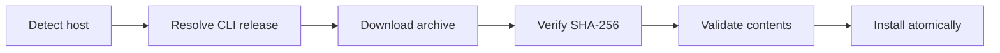

<div align="center">

# Cloudsmith CLI installer

Secure, cross-platform installation scripts for the standalone Cloudsmith CLI.

[](https://github.com/cloudsmith-io/cloudsmith-cli-install-script/actions/workflows/test.yml)
[](https://github.com/cloudsmith-io/cloudsmith-cli-install-script/actions/workflows/zizmor.yml)
[](LICENSE)

[Quick start](#quick-start) · [Configuration](#configuration) · [Supported targets](#supported-targets) · [Security](#security) · [Support](#support)

</div>

This repository is the canonical source for the scripts used to install the
[Cloudsmith CLI](https://github.com/cloudsmith-io/cloudsmith-cli) standalone
binary:

- `install.sh` for Linux and macOS using POSIX `sh`
- `install.ps1` for Windows using PowerShell

The scripts detect the host platform, download the matching release archive,
verify its SHA-256 checksum, and install the CLI into a versioned directory.
They do not modify `PATH` or authenticate with Cloudsmith.

> [!IMPORTANT]
> For reproducible CI builds, use a specific CLI version instead of `latest`.

## At a glance

| Capability | Behaviour |
| --- | --- |
| Platforms | Linux, macOS, and Windows on x86-64 and Arm where supported |
| Integrity | Verifies the release archive against its SHA-256 manifest |
| Installation | Uses versioned directories and atomic activation |
| Output | Emits four stable `key=value` lines for CI consumers |
| Side effects | Does not modify `PATH` or configure authentication |
| Distribution | Published as release assets and vendored into Cloudsmith CI/CD integrations |

## Quick start

Download the appropriate script from a tagged
[GitHub release](https://github.com/cloudsmith-io/cloudsmith-cli-install-script/releases)
and verify it against the release's `SHA256SUMS` file before running it.

### Linux or macOS

```sh
sh ./install.sh --version latest
```

### Windows

```powershell
./install.ps1 -Version latest
```

On success, use the reported `bin_dir` to update `PATH`, or invoke the reported
`executable` directly.

### Install from Cloudsmith

Tagged releases are also published to Cloudsmith at stable URLs, defaulting to
`latest`:

```sh
curl -fsSLO https://dl.cloudsmith.io/public/cloudsmith/cloudsmith-cli-install-script/raw/names/install.sh/versions/latest/install.sh
sh ./install.sh --version latest
```

```powershell
Invoke-WebRequest -Uri https://dl.cloudsmith.io/public/cloudsmith/cloudsmith-cli-install-script/raw/names/install.ps1/versions/latest/install.ps1 -OutFile install.ps1
./install.ps1 -Version latest
```

`SHA256SUMS` is published alongside at the same path pattern
(`.../raw/names/SHA256SUMS/versions/latest/SHA256SUMS`) for verification.
Replace `latest` with a tag's version (for example `0.1.0`) to pin a specific
release.

## How installation works



An existing verified installation is reused unless a forced reinstall is
requested. Concurrent installations are serialized with a lock.

## Requirements

| Installer | Supported host | Required tools |
| --- | --- | --- |
| `install.sh` | Linux or macOS | `curl`, or GNU `wget` with `--https-only`; `tar` and `gzip` for `.tar.gz` archives or `unzip` for `.zip` archives; and one of `sha256sum`, `shasum`, or `openssl` |
| `install.ps1` | Windows x86-64, or Windows Arm64 with x86-64 emulation | Windows PowerShell 5.1 or PowerShell 7+ |

After resolving the release manifest, the shell installer checks the required
archive and checksum tools before downloading the release archive.

## Configuration

Command-line options take precedence over environment variables.

| Shell option | PowerShell parameter | Environment variable | Default |
| --- | --- | --- | --- |
| `--version` | `-Version` | `CLOUDSMITH_CLI_VERSION` | `latest` |
| `--install-root` | `-InstallRoot` | `CLOUDSMITH_CLI_INSTALL_ROOT` | Shell: `$XDG_DATA_HOME/cloudsmith-cli` or `~/.local/share/cloudsmith-cli`<br>PowerShell: `%LOCALAPPDATA%\Cloudsmith\CLI` |
| `--target` | `-Target` | `CLOUDSMITH_CLI_TARGET` | Automatically detected |
| `--output-file` | `-OutputFile` | `CLOUDSMITH_CLI_OUTPUT_FILE` | Standard output |
| `--repository` | `-Repository` | `CLOUDSMITH_CLI_REPOSITORY` | `cloudsmith/cli` |
| `--manifest-url` | `-ManifestUrl` | `CLOUDSMITH_CLI_MANIFEST_URL` | Derived from the repository, version, and target |
| `--force` | `-Force` | Not applicable | Disabled |

Run `sh ./install.sh --help` for shell usage. PowerShell parameters support
standard `Get-Help` and tab completion.

<details>
<summary><strong>Advanced overrides</strong></summary>

The repository, manifest URL, and target overrides are intended for testing or
unusual environments. Normal installations should use the defaults.

If libc detection fails on an unusual Linux host, set the target explicitly
with `--target` or `CLOUDSMITH_CLI_TARGET`.

</details>

## Output contract

Each installer emits exactly four `key=value` lines to standard output, or to
the requested output file. Diagnostic messages are written to standard error.

```text
version=1.19.0
target=linux-x86_64-gnu
bin_dir=/home/runner/.local/share/cloudsmith-cli/1.19.0/linux-x86_64-gnu/cloudsmith
executable=/home/runner/.local/share/cloudsmith-cli/1.19.0/linux-x86_64-gnu/cloudsmith/cloudsmith
```

> [!NOTE]
> The four keys and their order form a public contract for CI/CD integrations.

## Supported targets

| Operating system | Architecture | Target | Runtime notes |
| --- | --- | --- | --- |
| Linux | x86-64 | `linux-x86_64-gnu` | glibc 2.28+ |
| Linux | Arm64 | `linux-aarch64-gnu` | glibc 2.28+ |
| Linux | x86-64 | `linux-x86_64-musl` | Alpine and other musl distributions |
| Linux | Arm64 | `linux-aarch64-musl` | Alpine and other musl distributions |
| macOS | x86-64 | `macos-x86_64` | Intel |
| macOS | Arm64 | `macos-arm64` | Apple silicon, including shells running under Rosetta 2 |
| Windows | x86-64 | `windows-x86_64` | Also used on Windows Arm64 through x86-64 emulation |

## Security

The installers apply the following safeguards:

- HTTPS-only downloads
- SHA-256 verification before extraction
- archive validation to reject absolute paths and parent-directory traversal
- executable validation with `cloudsmith --version` before activation
- atomic activation and serialized concurrent installs
- reuse only after validating an existing installation

The shell installer uses `curl` or `wget`; the PowerShell installer uses the
.NET web request stack. Standard proxy configuration and operating-system
certificate trust stores apply. All installer download requests send a
`cloudsmith-cli-install-script` user agent that includes the operating system
and architecture.

To report a potential vulnerability, follow the [security policy](SECURITY.md)
instead of opening a public issue.

## CI/CD integrations

Tagged releases publish `install.sh`, `install.ps1`, and `SHA256SUMS`. The
approved installer bytes are also vendored into:

| Integration | Installer consumer |
| --- | --- |
| GitHub Actions | [cloudsmith-cli-action](https://github.com/cloudsmith-io/cloudsmith-cli-action) |
| CircleCI | [Cloudsmith orb](https://github.com/cloudsmith-io/orb) |
| Azure DevOps | Cloudsmith CLI task for Azure Pipelines |

## Development

See [CONTRIBUTING.md](CONTRIBUTING.md) for the development workflow and
[tests/README.md](tests/README.md) for test-suite requirements.

## Releases and compatibility

Releases use `vX.Y.Z` tags, and published release assets are immutable.
Breaking changes to command-line options, environment variables, installation
layout, supported targets, or the output contract require a major version bump.

## Support

| Need help with | Where to go |
| --- | --- |
| Installer bug | [Open a bug report](https://github.com/cloudsmith-io/cloudsmith-cli-install-script/issues/new?template=bug_report.md) |
| Installer usage | [Ask a question](https://github.com/cloudsmith-io/cloudsmith-cli-install-script/issues/new?template=question.md) |
| Cloudsmith CLI behaviour | [Cloudsmith CLI repository](https://github.com/cloudsmith-io/cloudsmith-cli) |
| Account or private support | [Submit a Cloudsmith support request](https://support.cloudsmith.com/hc/en-us/requests/new) |
| Security concern | [Follow the private reporting process](SECURITY.md) |

See [SUPPORT.md](SUPPORT.md) for the information to include when requesting
help.

## License

Licensed under the [Apache License 2.0](LICENSE).
